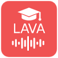
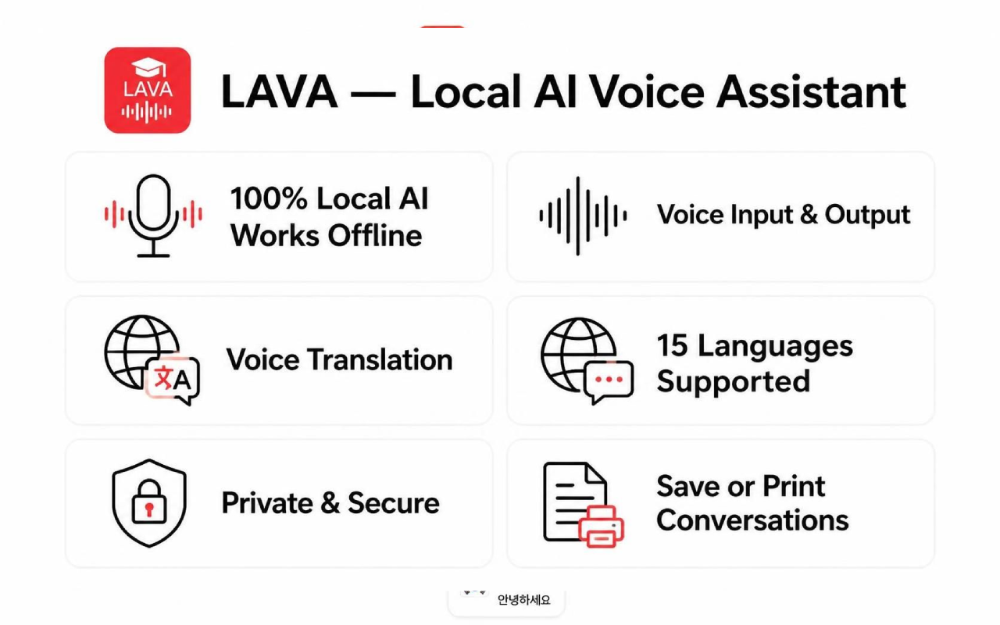
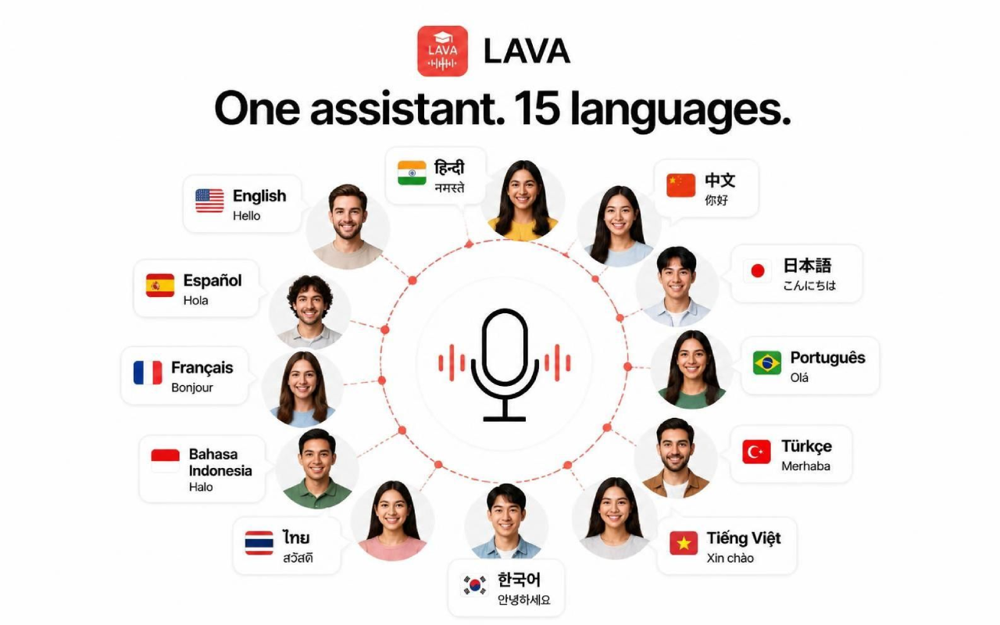

#  LAVA: Local AI Voice Assistant
> **Hands-free, 15 languages, ideal for students.**

LAVA- Local AI voice assistant. Talk to AI Locally - 100% on-device, no backend servers, works Offline, no Signup, maximum privacy, hands free mode, 100% Free & Unlimited, No API cost.

LAVA turns Google Chrome into a free AI companion with text and voice response that understand your spoken language and speaks answers instantly in multiple languages and works Offline without internet. Because it runs entirely on your own computer using Chrome’s built-in Gemini Nano AI, you get unlimited free usage without risking your privacy. Your data is never sent to any backend AI server for processing. It's Ultra lightweight on your CPU and Battery.

---

## 📸 Media Preview

| Multilingual Support (15 Languages) | Core Features Overview |
| :---: | :---: |
|  |  |

---

What Can You Do With It? 
1.Hands-Free Learning: Perfect for students looking to simply speak their STEM homework questions vocally and get instant answers just like Alexa and Google Home. 
2.Make use of Playbooks for instant simplification of topics, study notes, study guide, quiz preparation, mnemonic and exam preparation etc. Save responses to pdf or print directly to paper.
3.Improve Writing: LAVA helps you with better writing and articulating LinkedIn Post, Email, Essay, Cover Letter or Resume. Provide it a text or simple open pdf in your web browser and select text. 
4.Better Accessibility: An ideal web browsing companion for seniors or anyone who finds typing on a keyboard frustrating. Talk to webpages by selecting text.
5.Instant Translation: Speak naturally in one language and have LAVA translate and read it back in another.
6.Language Practice: Language learning companion, make use of supported langauges to learn a new language.

How It Works?
1. Click & Speak: Click the Mic button and talk naturally in any of the 15 supported languages. Or type out your questions, which works even when offline.
2. Local Processing: Chrome's built-in AI processes your questions completely offline. 
3. Audio Response: LAVA simultaneously types out the text and reads back the response out loud.

Why LAVA is Different?
1. Free and Unlimited: LAVA relies on an offline, on-device LLM ai model, so talk to the AI as much as you want. There are no monthly token caps or hidden API costs, no signup and no subscription headache, no privacy nightmare. 
2. Maximum privacy: Privacy-first AI with no backend ai servers and no training on your data, there is no tracking usages and zero telemetry.
3. Multilingual with Voice and Text response: Talk to LAVA in any language and receive response in supported 15 languages. Many use your OS voicepack automatically. Text to speech and speech to text built in.
4. Fully Optimized:  Ultra lightweight on your CPU and Battery, you will not notice a difference. 

LAVA is a state of the art, fully offline, on-device solution. By leveraging the latest AI technology built directly into Google Chrome, it delivers powerful AI features completely free of charge with absolutely no limits. Because LAVA is in active development, you can look forward to even more features launching soon. You can find LAVA in Chrome Extension Webstore at https://chromewebstore.google.com/detail/lava-local-ai-voice-assis/ldddhgaipfjeanombjgdofccfnpfkien

***

# 🌋 LAVA: Local AI Voice Assistant

**The ultimate privacy-first, 100% offline AI companion, a voice assistant that works offline for free; LAVA hears you and can speak to you in multiple different languages mimicking the functionality of Alexa and Google Home Mini.**

LAVA unlocks the hidden power of **Gemini Nano**, which is the built-in artificial intelligence model located directly inside your Google Chrome browser. This means there are no external servers, no paid subscriptions, and no data tracking—just a high-performance, on-device Large Language Model (LLM) that turns your web browser into a hands-free productivity hub that does not require an internet connection to function.

### 🚀 Why LAVA?
Stop sending your personal data to the cloud. LAVA leverages **local on-device AI processing**, which ensures your voice and text conversations never leave your physical computer (chrome web browser). Whether you are a student using it for study, a developer looking to understand code, or a privacy enthusiast, LAVA provides unlimited AI utility for free without the "privacy nightmare" associated with cloud-based AI. No signup account, No API, No local Server.

### 🛠️ Core Capabilities
- **🗣️ Hands-Free Voice Interaction:** LAVA uses speech-to-text to hear you and text-to-speech to talk back to you in 15+ different languages.
- **🔌 100% Offline Functionality:** Once the extension is installed, LAVA works completely without an internet connection (Offline Mode).
- **📚 Student Power-Tools:** Use "Playbooks" to instantly simplify complex STEM (Science, Technology, Engineering, Math) topics, create study guides, and generate mnemonic devices for exam preparation.
- **✍️ Professional Writing Suite:** LAVA helps you write and articulate LinkedIn posts, professional emails, essays, and resumes by allowing you to select text directly in your browser and asking the AI to improve it.
- **🌍 Instant Translation:** You can speak naturally in one supported language and have LAVA translate that speech and read it back to you in another supported language instantly.
- **♿ Enhanced Accessibility:** A perfect AI companion for seniors or people with motor impairments who find typing on a keyboard frustrating or difficult.
- **🗣️ Total Hands-Free Interaction:** LAVA supports a continuous, hands free mode. You can engage in indefinite conversations about any topic in any language without needing to click a button every time you speak.
- **🔌 100% Offline Functionality:** Once the extension is installed, LAVA works completely without an internet connection (Offline Mode).

### 🎙️ The Hands-Free Experience
LAVA can be set to **Hands-Free Mode**. This allows you to:
- **Maintain Flow:** Have long-form discussions, brainstorm ideas, or learn complex topics through natural, back-and-forth dialogue.
- **Multitask:** Get answers and insights while your hands are busy with other tasks, making it the perfect companion for coding, cooking, or studying.
- **Indefinite Conversation:** Because it's local and free, there are no "session timeouts" or API costs per message. Talk for as long as you want.

### ⚖️ LAVA vs. Cloud AI (The Comparison)

| Feature | LAVA (Local Offline AI) | Standard Cloud AI (ChatGPT/Claude) |
| :--- | :--- | :--- |
| **Privacy** | 🛡️ Maximum (Data stays on your PC, Cleared on restart.) | ⚠️ Data sent to company servers, they train on it, they sell it. |
| **Cost** | 💰 100% Free / No Token or API Limits | 💸 Ever Increasing Monthly Subscriptions/API Fees |
| **Internet** | 🚫 Not Required (Works Offline) | ✅ Required (Needs fast WiFi/Data) |
| **Setup** | ⚡ No Setup/ No Signup / No Account / No API | 📝 Account & Email, Subscription, Credit Card Required |
| **Server Latency** | 🚀 Instant Local Response No server needed | ⏳ Dependent on Network Speed |
| **Application** | 🚀 Fully free solid local features that you will actually use | ⏳ 1000s of bells and whistle when you only need one, and you are forced to pay for it |

### 📦 Installation
1. Visit the **[Chrome Web Store](https://chromewebstore.google.com/detail/lava-local-ai-voice-assis/ldddhgaipfjeanombjgdofccfnpfkien)**.
2. Click **"Add Extension to Chrome"**.
3. Start talking to your local, private AI instantly, free and unlimited.

### ⚙️ Technical Specifications
- **Engine:** Powered by Chrome’s built-in Gemini Nano AI model.
- **Resource Impact:** Optimized to be ultra-lightweight on your CPU and Battery Life.
- **Privacy Model:** Zero telemetry, zero backend servers, zero data collection and zero training on your personal conversations.

---

### 🏆 Recognition & Awards
LAVA is proud to be recognized as a **Google Chrome "Best New Extension"** for its innovative implementation of on-device AI. By pioneering the use of Gemini Nano for offline voice interaction, LAVA has set the benchmark for the next generation of private, browser-based assistants.

### 🌟 What Users Are Saying
-- *"The first AI assistant that actually respects my privacy. The offline voice mode is a game changer for my study flow."* — **TechReview Daily**
--*"Blown away by the local latency. It was near instant at under 2 seconds for simple questions. It's basically a super powered Alexa that lives in my Chrome browser. Looking forward to what else LAVA team is cooking."* — **Early Adopter Community**

---
**LAVA is currently in active development.** 
Join the revolution of 100% local, private, and free conversational AI. Experience the power of an on-device voice assistant that works completely offline.

***
